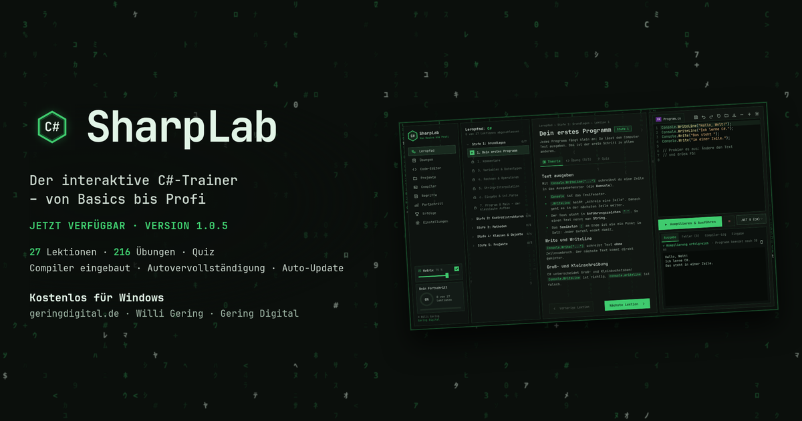

# SharpLab – Der interaktive C#-Trainer

Entwickelt von Willi Gering · Gering Digital

Eine Windows-App, mit der du C# von null an lernst: 27 Lektionen in 5 Stufen, 216 automatisch geprüfte Übungen, Quizfragen, ein Begriffstrainer und ein eingebauter C#-Compiler, mit dem du deinen Code direkt in der App ausführst.

## Download

**[⬇ SharpLab-Setup.exe herunterladen](https://github.com/willigering/SharpLab/releases/latest/download/SharpLab-Setup.exe)** (empfohlen)

1. `SharpLab-Setup.exe` starten. Die Installation läuft nur für dein Benutzerkonto, ohne Administratorrechte, nach `%LocalAppData%\Programs\SharpLab` – mit Startmenü- und (optional) Desktop-Verknüpfung.
2. Die App ist bislang nicht digital signiert. Wenn Windows SmartScreen warnt, prüfe die Herkunft des Downloads und die veröffentlichte SHA-256-Prüfsumme, bevor du eine Ausführung in Betracht ziehst. Eine Warnung nicht ungeprüft umgehen.
3. Benötigt die [.NET 8 Desktop Runtime](https://dotnet.microsoft.com/download/dotnet/8.0) (x64) oder neuer. Fehlt sie, bietet das Setup den Download an.

Portabel ohne Installation: [`SharpLab-Windows.zip`](https://github.com/willigering/SharpLab/releases/latest/download/SharpLab-Windows.zip) entpacken und `SharpLab.exe` starten. Alle Versionen: [Releases](../../releases).

Neue Versionen meldet SharpLab beim Start selbst und installiert sie auf Wunsch (abschaltbar in den Einstellungen). Deinstallieren: Windows-Einstellungen › Apps › SharpLab.

## Funktionen

- Lernpfad: Grundlagen, Kontrollstrukturen, Methoden, Klassen & Objekte, Projekte – je Lektion Theorie, 8 Übungen und ein Quiz
- Code-Editor mit Syntaxhervorhebung, Eingaben über `Console.ReadLine()` und Stopp-Knopf für Endlosschleifen
- Autovervollständigung wie in Visual Studio (alphabetisch, CamelCase-Filter, eigene Variablen) und Codeausschnitte (`cw` Tab Tab)
- Aufgaben nennen nur das Ziel, nicht den Lösungsweg; Tipps und Hinweise helfen bei Bedarf
- Freie Spielwiese zum Ausprobieren, Fortschritt und Erfolge
- Lernstand wahlweise in einem eigenen Ordner oder in OneDrive (für mehrere Rechner)
- Auto-Update über GitHub-Releases, Feedback direkt aus der App
- Matrixcode im Hintergrund wie im Film, mit Reglern für Helligkeit und Geschwindigkeit

Dein Fortschritt und dein Code werden unter `%AppData%\CSharpLernen` gespeichert und bleiben bei Updates und bei der Deinstallation erhalten.

## Selbst bauen

`CSharpLernen.sln` in Visual Studio öffnen und starten (Projekt- und Namespace-Namen heißen aus Kompatibilitätsgründen weiter `CSharpLernen`; die erzeugte Datei ist `SharpLab.exe`). Tests: `dotnet test`.

- Lektionen: liegen als JSON in der App und werden mit dem Generator unter `werkzeuge/lektionen-generator` erzeugt (`python3 build.py`).
- Release: `installer/release-bauen.sh` baut `SharpLab-Windows.zip` (portabel, wird vom Auto-Update benutzt) und `SharpLab-Setup.exe` (NSIS) samt `.sha256`.
- Feedback-Server: Vorlage unter `server/sharplab/feedback.php`.

## Lizenz

SharpLab steht unter der [MIT-Lizenz](LICENSE). Die Lizenzen der mitgelieferten Komponenten (Roslyn, AvalonEdit, JetBrains Mono u. a.) stehen in [THIRD-PARTY-NOTICES.txt](THIRD-PARTY-NOTICES.txt).

**Sicherheit und Datenschutz:** Der Code-Editor führt eingegebenen C#-Code im App-Prozess aus und ist keine Sicherheits-Sandbox. Führe nur Code aus vertrauenswürdigen Quellen aus. Feedback wird nur nach Klick auf „Senden“ übertragen; ein Fehlerprotokoll nur, wenn du die Option ausdrücklich auswählst. Details: https://geringdigital.de/datenschutz.php#sharplab. Automatische Updates setzen eine SHA-256-Prüfsumme im Release voraus; sie werden bei fehlender oder falscher Prüfsumme abgebrochen. Eine Prüfsumme ersetzt keine digitale Signatur.
